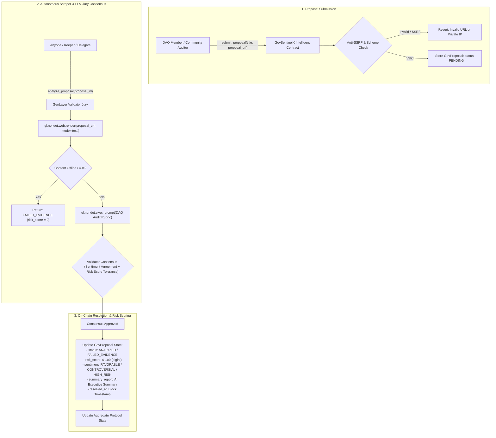

# GovSentinelX — AI-Driven DAO Proposal Impact & Compliance Scraper

> **Track:** AI Governance / Subjective Consensus / Autonomous Security Auditing  
> **Network:** GenLayer studionet (Chain ID: `61999` / `0xF1EF`)  
> **Target Environment:** [GenLayer Studio](https://studio.genlayer.com)  
> **Execution Engine:** GenVM / Optimistic Democracy Semantic Consensus  
> **Contract Source:** [`contracts/gov_sentinel_x.py`](contracts/gov_sentinel_x.py)  

---

## 1. Live Deployment & On-Chain Verification

The **GovSentinelX** Intelligent Contract is deployed, finalized, and verified on GenLayer **studionet**:

- **CONTRACT_ADDRESS:** `0x9ccC975433bfACA58E82a7F8D72b617c484f6860`
- **DEPLOYER_ADDRESS:** `0x33Ce552FBA45C17478aBc5778bDbc2c86E9a9A05`
- **TRANSACTION_HASH:** `0x29ec353949adf9d4d0c94a560555d82be5e14e14b1b5acd3b45aaee23608c390`
- **NETWORK:** `studionet` (Chain ID: `61999` / `0xF1EF`)
- **RPC_URL:** `https://studio.genlayer.com/api`
- **EXPLORER_LINK:** [View on GenLayer Studio Explorer](https://explorer-studio.genlayer.com/address/0x9ccC975433bfACA58E82a7F8D72b617c484f6860)
- **RECEIPT_STATUS:** `5` (FINALIZED)
- **RESULT:** `6` (SUCCESS)
- **Deployment Details:** [`deployment.json`](deployment.json)

---

## 2. Core Problem & The 1-Line Pitch

### The Core Problem
Major decentralized autonomous organizations (DAOs) such as Uniswap, Aave, Compound, and Arbitrum manage billions of dollars in treasury assets and protocol liquidity. Governance proposals submitted on platforms like Snapshot, Tally, and Discourse often span thousands of words laden with complex legalistic and technical jargon:
1. **Hidden Malicious Payload & Treasury Drains:** Proposals often disguise treasury drainage, unverified multisig beneficiaries, timelock removals, or governance attack vectors behind benign titles.
2. **Delegate Information Overload:** DAO delegates and token holders lack the time and smart contract security background to thoroughly audit dozens of complex proposals every week.
3. **Legacy Blockchain Blindness:** Solidity and standard EVM blockchains cannot access the external web (Snapshot, Tally, governance forums) and cannot understand natural language. They cannot read proposals, evaluate financial risk, or alert the community autonomously.

### Why This Primitive DIES Without GenLayer (The 1-Line Pitch)
> *"Without GenLayer's native on-chain web scraping (`gl.nondet.web.render`) and decentralized LLM validator jury consensus (`gl.vm.run_nondet`), no smart contract can autonomously scrape governance forums, detect hidden protocol risks, and produce binding risk assessments before millions in treasury funds are voted away."*

---

## 3. Architecture & System Flow



---

## 4. Key Protocol Innovations

### 1. Native On-Chain Web Scraping with SSRF Hardening
Validators fetch live governance proposals directly from Snapshot, Tally, or forum URLs via `gl.nondet.web.render(url, mode="text")`. The contract enforces strict URL validation (`_validate_proposal_url`) blocking private subnets (`127.0.0.1`, `localhost`, `10.*`, `192.168.*`, `172.16.*`, `169.254.*`, `::1`) to prevent internal network probing.

### 2. Multi-Validator Semantic Consensus
Rather than relying on brittle string comparisons, **GovSentinelX** employs GenLayer's Optimistic Democracy pattern:
- **Discrete Semantic Equivalence:** Leader and validators must agree on the qualitative sentiment category (`FAVORABLE`, `CONTROVERSIAL`, `HIGH_RISK`, or `FAILED_EVIDENCE`).
- **Bounded Risk Tolerance:** For active proposals, validator risk scores must align within a $\pm 20$ tolerance band.
- **Robust Exception Handling:** 404 pages, network dropouts, or unparseable payloads resolve gracefully to `FAILED_EVIDENCE` without halting execution or throwing uncaught exceptions.

### 3. GenVM Storage Law Compliance (R14)
Fully conforms to GenVM storage typing rules:
- Prohibits bare `int` in `@allow_storage @dataclass` definitions.
- Uses `bigint` for `risk_score`, `created_at`, `resolved_at`, and counters.
- Zero `TreeMap` reassignment in `__init__`.
- Single `gl.Contract` class per module.

---

## 5. Contract API Reference

### Write Methods
- `submit_proposal(title: str, proposal_url: str) -> str`: Registers a new proposal for analysis. Returns `proposal_id`.
- `analyze_proposal(proposal_id: str) -> None`: Triggers on-chain web scraping and multi-validator LLM consensus evaluation.

### View Methods
- `get_proposal(proposal_id: str) -> str`: Returns JSON-encoded proposal details (`submitter`, `title`, `url`, `status`, `risk_score`, `sentiment`, `summary_report`, timestamps).
- `get_proposal_count() -> int`: Returns total count of registered proposals.
- `get_owner() -> str`: Returns contract owner address.
- `get_stats() -> str`: Returns aggregate governance statistics (total, analyzed, high-risk, favorable, controversial, failed evidence).
- `get_proposals_page(offset: int, limit: int) -> str`: Returns paginated list of proposals for user interfaces and indexing bots.

---

## 6. Directory Structure

```
GovSentinelX/
├── contracts/
│   └── gov_sentinel_x.py        # Intelligent Contract (GenVM Python)
├── tests/
│   ├── conftest.py              # gltest harness & simulator mock installer
│   └── test_gov_sentinel_x.py   # 10 comprehensive unit & edge-case tests
├── scripts/
│   └── deploy_studionet.py      # Automated deployment script for GenLayer Studionet
├── deployment.json              # Verified on-chain deployment receipt
├── gltest.config.yaml           # gltest network and contract configuration
├── requirements-dev.txt         # Development dependencies
├── .env.example                 # Environment variable template
├── .gitignore                   # Version control ignore rules
├── README.md                    # Technical documentation & architecture
└── submission.md                # Portal builder track submission draft
```

---

## 7. Testing & Verification

The contract includes a complete test suite of 10 automated unit tests executed via `gltest` covering the full lifecycle and all edge cases:

```bash
# Run the complete test suite
pytest -v
```

### Test Suite Summary (10/10 Passing):
- `test_initial_state`: Validates initial counters, owner address, and storage setup.
- `test_submit_proposal_success`: Validates proposal submission and initial `PENDING` state.
- `test_submit_proposal_validations`: Tests rejection for short titles, invalid URL schemes, and SSRF attacks.
- `test_analyze_proposal_not_found`: Validates revert on non-existent proposal ID.
- `test_analyze_proposal_favorable`: Evaluates low-risk, standard parameter change proposals (`FAVORABLE`).
- `test_analyze_proposal_high_risk`: Evaluates critical governance attack / treasury drain proposals (`HIGH_RISK`).
- `test_analyze_proposal_controversial`: Evaluates divisive governance structure amendments (`CONTROVERSIAL`).
- `test_analyze_proposal_failed_evidence_404`: Handles dead links, 404 pages, and inaccessible content gracefully.
- `test_get_proposals_page`: Tests off-chain paginated data retrieval.
- `test_validator_mismatch_rejection`: Confirms consensus rejection when validator outcomes diverge.

---

## 8. Deployment on GenLayer Studionet

```bash
# Install dependencies
pip install -r requirements-dev.txt

# Run automated deployment
python scripts/deploy_studionet.py
```
